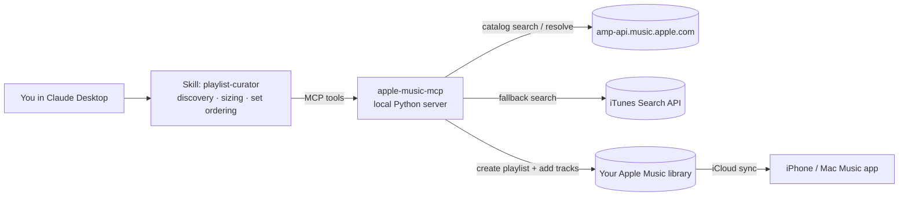

# playlist-generator · Apple Music MCP

Ask Claude for a playlist ("2 hours of techno that builds like a DJ set, Charlotte de Witte and Amelie Lens vibe") and it is **created directly in your Apple Music library**. You don't need Spotify, Tune My Music or the paid Apple Developer Program.



The work is split between two parts. **The skill decides.** It asks about duration, energy curve, reference artists and the known-vs-new ratio, then curates and orders the tracks as a journey. **The MCP server executes.** It verifies every track in the Apple Music catalog, creates the playlist and adds the tracks in order. Claude never adds a track that the catalog did not return.

## How auth works (and the trade-off)

The official Apple Music API needs a developer key from the Apple Developer Program, which costs about US$99/year. This project uses the same web API that **music.apple.com** uses:

- **Developer token**: a public JWT embedded in the web player's JavaScript. It is scraped automatically, cached and re-scraped when Apple rotates it.
- **User token**: the `media-user-token` cookie of your signed-in music.apple.com session. You paste it once with `apple-music-mcp login`. It is stored in `~/.config/apple-music-mcp/credentials.json` with `600` permissions and is only sent to Apple.

> The web API is undocumented. It has been stable for years, but Apple can change it without notice, and using it sits outside the official developer terms. It is fine for personal use, not for a commercial product. If something breaks, `apple-music-mcp doctor` tells you which step failed.

## Install (macOS)

You need [Claude Desktop](https://claude.ai/download) and [uv](https://docs.astral.sh/uv/) (`brew install uv`).

```bash
git clone https://github.com/eikesf/playlist-generator.git
cd playlist-generator
uv tool install .                 # installs the `apple-music-mcp` command
apple-music-mcp login             # paste your media-user-token (instructions are printed)
apple-music-mcp doctor --write    # live check: search, account, create + delete a test playlist
apple-music-mcp install-claude    # registers the server in Claude Desktop
```

Then:

1. **Restart Claude Desktop.** The `apple-music` tools appear in the tools/connectors menu.
2. **Install the skill.** In Claude, open Settings → Capabilities → Skills and upload `skill/playlist-curator.zip`. If you have an older `playlist-curator` skill (the Spotify/Tune My Music version), remove it first. The menu location may change between app versions.
3. Ask: *"Monta uma playlist de techno de 2 horas, estilo set, com Charlotte de Witte e Amelie Lens."*

**Claude Code** (optional): `install-claude` prints the exact `claude mcp add --scope user apple-music -- ...` command. It also copies the skill to `~/.claude/skills/playlist-curator`.

**Getting the token.** `apple-music-mcp login` prints these steps:

- **Safari**: Settings → Advanced → enable *Show features for web developers*. Open music.apple.com and sign in, then go to Develop → Show Web Inspector → Storage → Cookies → `media-user-token`.
- **Chrome**: on music.apple.com press ⌘⌥I, then go to Application → Cookies → `media-user-token`.
- **Automatic**: `uv tool install --force '.[browser]' && uvx playwright install chromium`, then `apple-music-mcp login --browser` opens a window. Sign in there and both tokens are captured.

## MCP tools

| Tool | What it does |
|---|---|
| `auth_status` | Checks the tokens and the account storefront, and says what to do if login is needed |
| `artist_top_songs` | Returns an artist's most popular catalog songs (to sample their style) |
| `search_songs` | Free-text catalog search (max 25) |
| `resolve_tracks` | Batch-verifies `Artist1, Artist2 - Title (Remix)` lines: fuzzy match, rejects live, karaoke, covers or the wrong remix, removes duplicate radio edits, reports what was not found and the total duration |
| `create_playlist` | Creates a library playlist from ordered ids or free-text lines; has a `dry_run` option |
| `add_tracks_to_playlist` | Appends tracks to an existing playlist |
| `list_playlists` / `get_playlist_tracks` | Reads your library to verify a playlist or extend it |
| `export_playlist_text` | Fallback: writes a `.txt` file for Tune My Music when the library is unreachable |

## Limitations

- **No BPM or energy data.** Apple's catalog doesn't expose tempo, and Spotify closed its audio-features endpoint to new apps in 2024. The skill estimates BPM and energy from Claude's knowledge to order sets, so the result is good but not beat-matched.
- **The playlist gets created on the Mac.** The server runs locally, so playlist creation happens in Claude Desktop on the Mac. The playlist then syncs to the iPhone through iCloud Music Library, which must be on (Settings → Music → Sync Library).
- **The user token expires.** Apple ends web sessions now and then. When tools report `AUTH`, run `apple-music-mcp login` again.
- **Region-locked tracks.** Some tracks don't exist in your storefront (for example `br`). `resolve_tracks` reports them instead of guessing.

## Troubleshooting

| Symptom | Fix |
|---|---|
| `AUTH: Apple Music user token missing or expired` | `apple-music-mcp login` |
| `Could not extract the Apple Music developer token` | Apple changed the web player. Copy the `Authorization: Bearer ...` value from any `amp-api.music.apple.com` request in the browser devtools Network tab, and set `APPLE_MUSIC_DEVELOPER_TOKEN` in the `env` of the Claude Desktop config. Then open an issue. |
| Tools don't show up in Claude Desktop | Run `apple-music-mcp install-claude` again and fully quit Claude Desktop (⌘Q). Check `~/Library/Logs/Claude/mcp*.log`. |
| Playlist not on the iPhone | Wait a few minutes and check that Sync Library is on. |

## Development

```bash
uv venv && uv pip install -e ".[dev]"
uv run pytest -q        # 61 tests, no network needed
uv run ruff check .
python scripts/package_skill.py   # rebuild skill/playlist-curator.zip after editing SKILL.md
```

The tests run against `tests/fake_apple.py`, a stateful fake of the web player, amp-api and iTunes Search. It enforces auth like Apple does: 401 for a bad developer token, 403 for a bad user token, 400 for oversized requests. The suite includes an end-to-end simulated techno-set session and a real stdio subprocess handshake. Live behaviour is checked by `apple-music-mcp doctor`.

```
src/apple_music_mcp/
  config.py         credentials file, env overrides, JWT expiry, masking
  tokens.py         developer-token scraping from the web player
  client.py         amp-api client (catalog, library, retries, auth errors) + iTunes fallback
  resolver.py       free-text → catalog id matching, dedupe, duration report
  server.py         MCP tools (stdio)
  cli.py            serve / login / status / doctor / install-claude
  browser_login.py  optional Playwright token capture
skill/playlist-curator/SKILL.md   the Claude skill
```

## Guia rápido (pt-BR)

1. No Terminal do Mac: `brew install uv`, depois `git clone` do repo, `cd playlist-generator` e `uv tool install .`.
2. Rode `apple-music-mcp login` e cole o cookie `media-user-token` do music.apple.com (o comando mostra o passo a passo).
3. Rode `apple-music-mcp doctor --write`. Todos os itens precisam aparecer como `[ok]`.
4. Rode `apple-music-mcp install-claude` e reinicie o Claude Desktop (⌘Q).
5. Suba `skill/playlist-curator.zip` em Configurações → Capabilities → Skills e remova a skill antiga.
6. Peça a playlist no Claude Desktop. Ela aparece no app Música do Mac e no iPhone em poucos minutos.

## License

MIT
