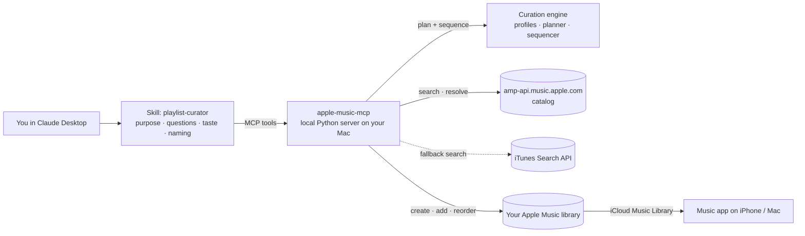
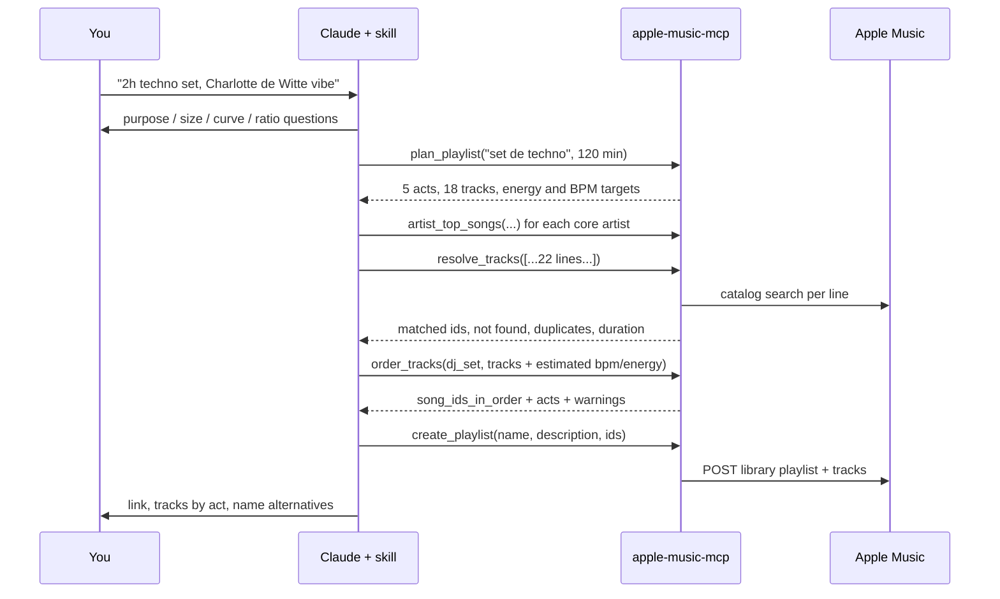

# playlist-generator · Apple Music playlist agent for Claude

> *"Monta uma playlist de techno de 2 horas que vá crescendo como um set, com Charlotte de Witte e Amelie Lens."*
> A few minutes later the playlist is in your Apple Music library, verified track by track and sequenced like a DJ set. You don't need Spotify, a file to import or a paid Apple developer account.

This project is a **Claude skill** plus a **local MCP server**. Together they turn a conversation into a finished Apple Music playlist. Claude works out *why* you want the playlist (study, workout, a techno set, a party...) and plans its energy curve. It picks tracks, verifies every one in the Apple Music catalog, puts them in order and creates the playlist in your library. Later it can add tracks and **re-sequence the playlist automatically**, and the changes show up in the Music app on your Mac and iPhone.

---

## Contents

1. [The story](#the-story)
2. [What it does](#what-it-does)
3. [How it works](#how-it-works)
4. [Purpose profiles](#purpose-profiles)
5. [Install and set up (macOS)](#install-and-set-up-macos)
6. [Using it](#using-it)
7. [MCP tools reference](#mcp-tools-reference)
8. [Tech stack and why](#tech-stack-and-why)
9. [Architecture](#architecture)
10. [Key decisions](#key-decisions)
11. [Security and privacy](#security-and-privacy)
12. [Testing strategy](#testing-strategy)
13. [Limitations](#limitations)
14. [Troubleshooting](#troubleshooting)
15. [Development](#development)
16. [Project history](#project-history)
17. [Guia rápido (pt-BR)](#guia-rápido-pt-br)

---

## The story

**Version 0: a prompt.** I listen on Apple Music, and I asked Claude to build me a techno playlist. Claude used the Spotify connector to search tracks, but Spotify's playlist-creation tool requires Premium and I had a free account. Claude wrote a text/JSON file instead, I uploaded it to Tune My Music, and Tune My Music recreated the playlist in Apple Music. The result was good: the playlist progressed like a real set. The process was clunky, though, with three services, a manual import and a "missing tracks" report to fix by hand.

**Version 1: a skill.** I turned that workflow into a Claude skill (`playlist-curator`). It asked discovery questions (energy curve, known vs new artists, vocals), curated about 75 tracks, ordered them in five acts and exported the file for Tune My Music. The curation was repeatable now, but delivery still was not.

**Version 2: this project.** The goal: *I ask, and the playlist exists in Apple Music.* That meant three things:

- **Talk to Apple Music directly.** The official API needs the paid Apple Developer Program, so this project uses the same web API that music.apple.com uses, authenticated with your own browser session ([ADR 0001](docs/adr/0001-web-player-auth.md)).
- **Make the curation smarter about purpose.** Study music, a workout and a techno set need different energy curves, tempos and track lengths, so purposes became data and ordering became an algorithm ([ADR 0004](docs/adr/0004-estimated-features-deterministic-sequencing.md)).
- **Keep playlists alive.** When tracks are added or swapped, the whole set re-sequences itself in Apple Music ([ADR 0005](docs/adr/0005-playlist-edit-strategies.md)).

It was built autonomously overnight by Claude Code from my specification, as a series of issues and stacked pull requests with CI. It is meant to be shared: if you use Apple Music and Claude Desktop on a Mac, you can run it too.

## What it does

- **Understands the purpose** (study, workout, running, party, DJ-style set, chill, sleep, genre exploration) and asks only the questions that matter: size, energy curve, known vs new ratio, vocals, reference artists and tracks.
- **Plans the playlist.** From the purpose and duration it computes the acts, how many tracks go in each act, and the target energy and tempo along the way. For example, 2 h of techno comes out as 18 tracks in five acts.
- **Knows your taste.** It reads your library, recently played tracks, heavy rotation and your love/dislike ratings from Apple Music. Every verified track is tagged *known* or *new*, so the known/new ratio you ask for is measured, not guessed, and disliked songs are flagged and left out.
- **Discovers with Apple's data**: similar artists from the catalog, and top songs from those artists that you don't know yet.
- **Verifies every track** against the Apple Music catalog for your storefront. Fuzzy matching handles accents, "feat.", collabs and remixes. It rejects karaoke, live and cover versions and the wrong remixer, removes radio-edit duplicates, and reports what isn't available instead of guessing.
- **Sequences like a DJ.** Claude estimates BPM and energy per track, and a deterministic algorithm orders the tracks along the purpose's energy curve, with smooth tempo steps, no artist back to back and pinned tracks respected.
- **Creates the playlist in your library**, in order, with name and description. iCloud syncs it to the iPhone.
- **Edits existing playlists without breaking the vibe.** New tracks are **inserted exactly where they fit**: the existing order stays untouched and each new track goes into the slot that best matches the energy curve, BPM flow and artist spacing. Removing a track keeps everything else in order. You can also reorder, rename or fully re-sequence on request. Edits are verified by reading the playlist back.
- **Has fallbacks.** If the catalog API is unavailable, search falls back to the public iTunes Search API. If you're logged out, it can export a `.txt` file for Tune My Music.
- **Diagnoses itself.** `apple-music-mcp doctor --write` tests the whole chain live: token, search, account, create, reorder, delete.

## How it works



The **skill** does the parts that need judgement: the conversation, picking the purpose, taste, BPM and energy estimates, the name. The **server** does the parts that must be exact: verification, sequencing math, API calls. Claude never adds a track that the catalog did not return.

A typical session:



## Purpose profiles

| Purpose (`key`) | Energy curve | Tempo | Typical track | Vocals |
|---|---|---|---|---|
| DJ-style set (`dj_set`) | opening 3→4 · groove 4→6 · build 6→8 · **peak 8.5→10** · cooldown 7→4 | 118–140 BPM, ±4 per step | 6.5 min | sparse / ethereal |
| Workout (`workout`) | warm-up 5→7 · **main 8→9 (80%)** · cooldown 6→4 | 120–150 | 3.8 min (max 6) | any |
| Running (`running`) | warm-up · steady 7.5→8 · final push 9→10 · cooldown | 150–180 (or half time) | 3.8 min | any |
| Study / focus (`study`) | settle 3→3.5 · **deep focus 3.5 flat** · wind-down | 60–110 | 4.5 min | instrumental |
| Party (`party`) | arrival · rising · **peak 9→9.5** · sing-along finish | 100–130 | 3.5 min | prominent |
| Chill / daily (`chill`) | gentle wave 4→6→4 | 80–120 | 3.8 min | any |
| Relax / sleep (`sleep`) | 3 → 1, descending | 50–80 | 5 min | none / soft |
| Genre exploration (`exploration`) | five-act journey 4→9→4 | 80–140 | 4.2 min | any |

Profiles are plain data in [`curation/profiles.py`](src/apple_music_mcp/curation/profiles.py). Free text in Portuguese or English picks one: "treino", "música para estudar", "set de techno", "festa", "corrida". Adding a purpose means adding one entry.

## Install and set up (macOS)

You need **Claude Desktop** ([download](https://claude.ai/download)), an **Apple Music subscription** and **uv** (`brew install uv`).

```bash
git clone https://github.com/eikesf/playlist-generator.git
cd playlist-generator
uv tool install .                 # installs the `apple-music-mcp` command
apple-music-mcp login             # paste your media-user-token (steps are printed)
apple-music-mcp doctor --write    # live check: search, account, create + reorder + delete a test playlist
apple-music-mcp install-claude    # registers the server in Claude Desktop (backs up your config)
```

1. **Restart Claude Desktop** (⌘Q, then reopen). The `apple-music` tools appear in the tools/connectors menu.
2. **Add the skill.** Upload `skill/playlist-curator.zip` under Settings → Capabilities → Skills, and remove any older `playlist-curator` skill. The menu location can change between app versions.
3. Ask for a playlist.

**Getting the token** (`login` prints these steps):

- **Safari**: Settings → Advanced → enable *Show features for web developers*. Sign in at music.apple.com, then go to Develop → Show Web Inspector → Storage → Cookies → copy `media-user-token`.
- **Chrome**: sign in at music.apple.com, press ⌘⌥I, then go to Application → Cookies → `media-user-token`.
- **Automatic**: `uv tool install --force '.[browser]' && uvx playwright install chromium`, then `apple-music-mcp login --browser`. Sign in in the window that opens.

**Claude Code** (optional): `install-claude` prints the `claude mcp add --scope user apple-music -- ...` command and copies the skill to `~/.claude/skills/`.

## Using it

Example requests:

- *"Playlist de 1h30 para estudar, instrumental, estilo trilha sonora e ambient."*
- *"Treino de 60 minutos, techno pesado, quero energia alta o tempo todo."*
- *"Set de 2 horas de melodic techno estilo Afterlife, crescendo até um pico e fechando emocional."*
- *"Adiciona essas 5 músicas na minha playlist 'Warehouse Ascension' nos lugares certos."* Each one is inserted where it fits, and nothing else moves.
- *"Tira as faixas do Boris Brejcha e reordena."*

What you get back: the playlist link, the tracks grouped by act with durations, the purpose profile used, a decisive name with two alternatives, descriptions ready to paste, and honest notes about artists with too few tracks or tracks that weren't in the catalog.

## MCP tools reference

| Tool | Purpose |
|---|---|
| `auth_status` | Checks the developer token, user token and account storefront, and says what to do if login is needed |
| `my_taste_profile` | Your top artists (library + recently played + heavy rotation) and recent tracks |
| `similar_artists` | Artists Apple considers similar |
| `discover_tracks` | Top songs of similar artists that you don't know yet and haven't disliked |
| `list_playlist_profiles` | Lists the purpose profiles |
| `plan_playlist` | Purpose + duration/track count → acts, tracks per act, target energy and BPM, rules |
| `artist_top_songs` | An artist's most popular catalog songs (to sample their style) |
| `search_songs` | Free-text catalog search (max 25) |
| `resolve_tracks` | Batch-verifies `Artist1, Artist2 - Title (Remix)` lines: match, low confidence, not found, duplicates, total duration |
| `order_tracks` | Sequences verified tracks along the purpose's energy curve using estimated BPM/energy |
| `create_playlist` | Creates a library playlist from ordered ids or free-text lines (`dry_run` available) |
| `add_tracks_to_playlist` | Appends tracks |
| `insert_tracks_into_playlist` | **Adds tracks to an existing playlist, each at the position where it fits, keeping the current order intact** |
| `resequence_playlist` | Reshuffles the whole playlist from scratch along the energy curve (only when you ask for it) |
| `reorder_playlist` | Same tracks, new order |
| `sync_playlist` | Makes a playlist match an exact ordered list |
| `remove_tracks_from_playlist` | Removes tracks and keeps the rest in order |
| `rename_playlist` | Changes the name and/or description |
| `list_playlists` / `get_playlist_tracks` | Reads your library |
| `export_playlist_text` | Offline fallback: `.txt` file for Tune My Music |

CLI: `apple-music-mcp serve | login [--browser] | status | doctor [--write] | install-claude`.

## Tech stack and why

| Piece | Why |
|---|---|
| **Python 3.11+** | Main language of the author; mature async; easy distribution with uv |
| **MCP Python SDK 2.x** (`MCPServer`, stdio) | Official SDK. stdio is what Claude Desktop and Claude Code launch. Tool schemas come from type hints |
| **httpx** (async) | Modern HTTP client with a pluggable transport, so it can be tested with **respx** |
| **rapidfuzz** | Fast, MIT-licensed fuzzy matching for resolving tracks |
| **pydantic** (via the MCP SDK) | Typed, validated tool inputs (`TrackInput` with energy 1–10) |
| **Playwright** (optional extra) | One-click token capture from a real browser window |
| **uv · hatchling** | Install as a global CLI (`uv tool install .`); the skill ships inside the wheel |
| **pytest · pytest-asyncio · respx · ruff** | Tests, async tests, HTTP fakes, lint/format |
| **GitHub Actions** | CI on Ubuntu + macOS × Python 3.11 / 3.13 for every PR |

## Architecture

```
src/apple_music_mcp/
├── apple/                    Integration layer (everything that talks to Apple)
│   ├── errors.py             AppleMusicError › AuthError › TokenScrapeError
│   ├── http.py               RetryPolicy + send_with_retry (shared), browser UA
│   ├── tokens.py             web-player JWT scraping + DeveloperTokenProvider (cache/rotate)
│   ├── transport.py          AmpTransport: headers, auth, retries, 401 refresh, pagination
│   ├── catalog.py            CatalogService: search, artists, top songs, iTunes fallback
│   ├── itunes.py             ITunesSearch (public, no auth)
│   └── library.py            LibraryService: storefront, playlists CRUD, add/remove tracks
├── curation/                 Domain: purpose → plan → order
│   ├── profiles.py           8 purpose profiles (data) + free-text resolution
│   ├── planner.py            acts, minutes, tracks per act, targets
│   └── sequencer.py          greedy + incremental local search along the energy curve
├── resolver.py               free text → catalog id (fuzzy scoring, versions, dedupe)
├── editing.py                PlaylistEditor + InPlace/Rebuild strategies
├── ports.py                  protocols the domain depends on (SongSearcher)
├── text.py                   normalization shared by matching and sequencing
├── models.py                 Song, Artist, Playlist, PlaylistEntry
├── config.py                 credentials (0600), env overrides, state store
├── container.py              composition root: wires everything once
├── tools/                    MCP adapters, one module per domain + @tool_errors
├── commands/                 CLI adapters: login, doctor (list of Checks), install
├── cli.py · server.py        entry points
└── browser_login.py          optional Playwright token capture
skill/playlist-curator/       the Claude skill (+ zip for upload)
docs/adr/                     architecture decision records
tests/                        120+ tests, including a stateful fake Apple API
```

**SOLID in practice**
- **Single responsibility**: the transport changes when Apple's HTTP contract changes, the catalog when search semantics change, the sequencer when ordering rules change.
- **Open/closed**: new purpose profiles, doctor checks, MCP tool modules and edit strategies are additions, not modifications.
- **Liskov / interface segregation**: anything with `search_songs` is a `SongSearcher` (catalog, iTunes, fakes).
- **Dependency inversion**: domain code receives its collaborators. Only `container.py` knows how to build them, so tests swap in fakes.
- **DRY**: one retry policy, one error mapper for every tool, one normalization module, one private-file writer.

## Key decisions

All are recorded as ADRs in [`docs/adr/`](docs/adr/README.md):

1. [Web-player auth instead of a US$99/yr developer key](docs/adr/0001-web-player-auth.md). It's free but unofficial.
2. [Skill for judgement, MCP server for execution](docs/adr/0002-skill-plus-mcp-server.md).
3. [Apple Music catalog as the only source of truth](docs/adr/0003-apple-catalog-as-source.md). Spotify was dropped.
4. [LLM estimates BPM/energy, a deterministic algorithm sequences](docs/adr/0004-estimated-features-deterministic-sequencing.md).
5. [Playlist edits through strategies with restore and fallback](docs/adr/0005-playlist-edit-strategies.md).
6. [Stateful fake API for tests, `doctor` for live checks](docs/adr/0006-testing-with-a-stateful-fake.md).
7. [Stack and layered architecture](docs/adr/0007-stack-and-layered-architecture.md).
8. [Local credentials and secret scanning](docs/adr/0008-local-credentials-and-secret-scanning.md).
9. [Small stacked PRs, one issue each](docs/adr/0009-stacked-pull-requests.md).

## Security and privacy

- Your `media-user-token` is stored only in `~/.config/apple-music-mcp/credentials.json` (directory 0700, file 0600). It is sent only to Apple's servers and is masked in all output.
- Nothing is sent to any third party. The server runs on your Mac and talks only to `music.apple.com`, `amp-api.music.apple.com` and `itunes.apple.com`.
- The repository never contains credentials. `.gitignore` blocks env files, credential files, browser profiles and keys, and CI runs a secret scan ([`tests/test_secrets.py`](tests/test_secrets.py)) that fails on anything that looks like a token or key. `.env.example` documents the optional variables with empty values.
- `login` validates a token with Apple **before** saving it.
- To revoke access, sign out of music.apple.com in the browser where you copied the token, and delete `~/.config/apple-music-mcp/`.

## Testing strategy

- **Stateful fake Apple API** ([`tests/fake_apple.py`](tests/fake_apple.py)): web player HTML and bundle, amp-api catalog and library, and iTunes Search, with Apple-like auth errors and limits. It has switches for unsupported endpoints and midway failures.
- **Levels**:
  - unit tests (resolver scoring, profiles, planner math, sequencer behavior and performance, config)
  - service tests (catalog, library, editor strategies including restore)
  - MCP protocol tests (an in-process client, plus a **real stdio subprocess** with the legacy `initialize` handshake that Claude Desktop uses)
  - **end-to-end simulations** of whole sessions (plan → resolve → order → create → read back, and create → resequence → remove → rename)
- **Live checks**: `apple-music-mcp doctor --write` on your Mac.
- `uv run pytest -q` runs 120+ tests in about 6 seconds, offline.

## Limitations

- **Unofficial API.** It's stable in practice, but Apple can change it without notice, and it sits outside the official developer terms. Use it personally, not commercially.
- **Not verified live by the author's build environment.** It was developed in a sandbox without access to Apple's domains, so run `doctor --write` once after setup. The request shapes come from open-source clients and are encoded in the fake.
- **BPM and energy are estimates.** Neither Apple nor Spotify (for new apps, since 2024) provides audio features, so the sequencing quality depends on Claude's estimates.
- **The user token expires** now and then. Run `apple-music-mcp login` again when tools report `AUTH`.
- **In-place editing depends on your account accepting track removal.** If it doesn't, nothing is changed automatically. Claude shows the exact manual steps and asks whether to recreate the playlist (same name and order, new link), and recommends recreating only for large changes. `doctor --write` tells you which case applies.
- **Mac only for creation.** The server runs locally, so create playlists from Claude Desktop on the Mac. They sync to the iPhone via iCloud Music Library (Settings → Music → Sync Library).
- **Region-locked tracks** are reported as not found for your storefront.

## Troubleshooting

| Symptom | Fix |
|---|---|
| `AUTH: Apple Music user token missing or expired` | `apple-music-mcp login` |
| `Could not extract the Apple Music developer token` | Apple changed the web player. Copy the `Authorization: Bearer …` value from any `amp-api.music.apple.com` request in the browser devtools Network tab, set it as `APPLE_MUSIC_DEVELOPER_TOKEN` in the server's `env` in the Claude Desktop config, and open an issue |
| Tools don't appear in Claude Desktop | Run `apple-music-mcp install-claude` again, quit with ⌘Q and reopen. Logs are in `~/Library/Logs/Claude/mcp*.log` |
| Playlist not on the iPhone | Wait a few minutes and check that Sync Library is on |
| An edit reports `needs_decision` | Your account refused in-place edits. Nothing was removed or moved. Claude shows the manual steps and asks whether to recreate the playlist (same name and order, new link) or let you adjust by hand |
| A track is "not found" but exists | Check your storefront (`apple-music-mcp status`). Try `search_songs` with a shorter query |

## Development

```bash
uv venv && uv pip install -e ".[dev]"
uv run pytest -q
uv run ruff check . && uv run ruff format --check .
python scripts/package_skill.py   # rebuild skill/playlist-curator.zip after editing SKILL.md
uvx pre-commit install            # optional: gitleaks + ruff + secret guard before each commit
```

Contributions: open an issue first, keep PRs small, and add tests against the fake for any new endpoint. Never commit credentials (CI will refuse).

## Project history

| PR | Issue | Step |
|---|---|---|
| #6 | #2 | Scaffold, CI, local credential storage |
| #7 | #3 | Apple Music client, developer-token scraping, track resolver |
| #8 | #4 | Library playlist creation, MCP server, end-to-end simulation |
| #9 | #5 | `login` / `doctor` / `install-claude` CLI, skill v2, docs |
| #15 | #11 | Secrets hygiene: gitignore, `.env.example`, secret scan |
| #16 | #10 | Refactor into a layered SOLID/DRY architecture |
| #17 | #12 | Purpose-driven curation engine: profiles, plan, sequencing |
| #18 | #13 | Edit existing playlists: reorder, sync, remove, resequence, rename |
| #19 | #14 | This README and the ADRs |
| #21 | #20 | Insert new tracks at their best position without reshuffling the playlist |
| #26 | #22 | Never recreate a playlist without asking; manual steps for small changes |
| #27 | #23 | Taste-aware discovery: library, recently played, ratings, similar artists |

## Guia rápido (pt-BR)

**O que é:** você pede uma playlist no Claude Desktop e ela aparece pronta no Apple Music. A ordem segue a finalidade da playlist: estudo, treino, corrida, festa, set de techno, relaxar ou explorar um gênero. Depois dá para pedir "adiciona essas músicas": cada uma entra na posição certa para manter a vibe, sem mexer na ordem das outras. Remover também mantém a ordem do resto.

**Instalação no Mac (uns 10 minutos):**
1. `brew install uv`
2. `git clone https://github.com/eikesf/playlist-generator.git && cd playlist-generator && uv tool install .`
3. `apple-music-mcp login` e cole o cookie `media-user-token` do music.apple.com (o comando mostra o passo a passo no Safari e no Chrome).
4. `apple-music-mcp doctor --write`. Todos os itens precisam aparecer como `[ok]`. Esse comando cria, reordena e apaga uma playlist de teste.
5. `apple-music-mcp install-claude` e reinicie o Claude Desktop (⌘Q).
6. Suba `skill/playlist-curator.zip` em Configurações → Capabilities → Skills e remova a skill antiga.

**Importante:** a API usada não é oficial (é a do site music.apple.com). Ela é gratuita, mas pode mudar sem aviso. O seu token fica só no seu Mac, com permissão 600, e nunca vai para o repositório.

## License

[MIT](LICENSE)
