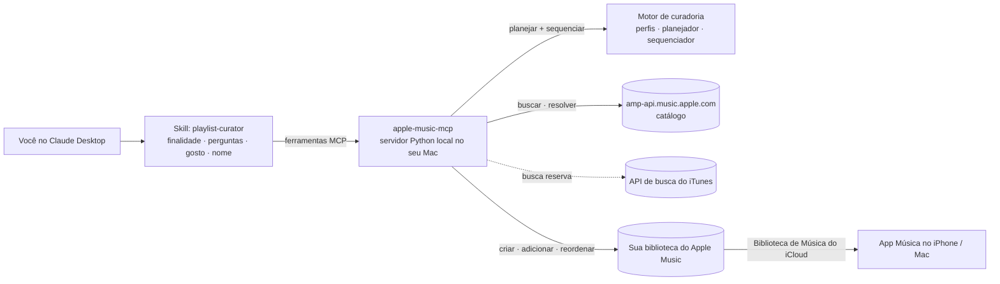
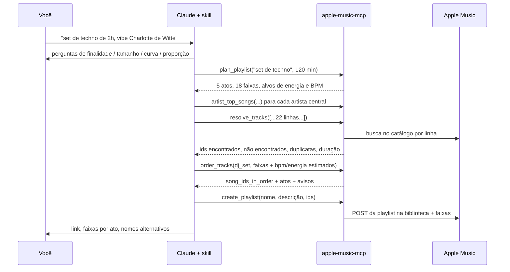

# playlist-generator · agente de playlists do Apple Music para o Claude

🇺🇸 [Read in English](README.md)

> *"Monta uma playlist de techno de 2 horas que vá crescendo como um set, com Charlotte de Witte e Amelie Lens."*
> Alguns minutos depois a playlist está na sua biblioteca do Apple Music, verificada faixa por faixa e sequenciada como um set de DJ. Você não precisa de Spotify, de arquivo para importar nem de conta paga de desenvolvedor da Apple.

Este projeto é uma **skill do Claude** mais um **servidor MCP local**. Juntos, eles transformam uma conversa em uma playlist pronta no Apple Music. O Claude entende *por que* você quer a playlist (estudar, treinar, um set de techno, uma festa...) e planeja a curva de energia. Ele escolhe as faixas, verifica cada uma no catálogo do Apple Music, coloca em ordem e cria a playlist na sua biblioteca. Depois ele pode adicionar faixas e **resequenciar a playlist automaticamente**, e as mudanças aparecem no app Música do Mac e do iPhone.

---

## Conteúdo

1. [A história](#a-história)
2. [O que faz](#o-que-faz)
3. [Como funciona](#como-funciona)
4. [Perfis de finalidade](#perfis-de-finalidade)
5. [Instalação e configuração (macOS)](#instalação-e-configuração-macos)
6. [Como usar](#como-usar)
7. [Referência das ferramentas MCP](#referência-das-ferramentas-mcp)
8. [Stack técnica e por quê](#stack-técnica-e-por-quê)
9. [Arquitetura](#arquitetura)
10. [Outros serviços de streaming (roadmap)](#outros-serviços-de-streaming-roadmap)
11. [Decisões principais](#decisões-principais)
12. [Segurança e privacidade](#segurança-e-privacidade)
13. [Estratégia de testes](#estratégia-de-testes)
14. [Limitações](#limitações)
15. [Solução de problemas](#solução-de-problemas)
16. [Desenvolvimento](#desenvolvimento)
17. [Histórico do projeto](#histórico-do-projeto)

---

## A história

**Versão 0: um prompt.** Eu escuto no Apple Music e pedi ao Claude uma playlist de techno. O Claude usou o conector do Spotify para buscar as faixas, mas a ferramenta de criar playlist do Spotify exige Premium, e minha conta era gratuita. Então o Claude escreveu um arquivo texto/JSON, eu subi no Tune My Music, e o Tune My Music recriou a playlist no Apple Music. O resultado ficou bom: a playlist evoluía como um set de verdade. O processo é que era desajeitado: três serviços, uma importação manual e um relatório de "faixas faltando" para corrigir na mão.

**Versão 1: uma skill.** Transformei esse fluxo em uma skill do Claude (`playlist-curator`). Ela fazia perguntas de descoberta (curva de energia, artistas conhecidos vs. novos, vocais), fazia a curadoria de umas 75 faixas, ordenava em cinco atos e exportava o arquivo para o Tune My Music. A curadoria passou a ser repetível, mas a entrega ainda não.

**Versão 2: este projeto.** O objetivo: *eu peço, e a playlist existe no Apple Music.* Isso exigia três coisas:

- **Falar direto com o Apple Music.** A API oficial exige o Apple Developer Program, que é pago, então este projeto usa a mesma API web que o music.apple.com usa, autenticada com a sua própria sessão do navegador ([ADR 0001](docs/adr/0001-web-player-auth.md)).
- **Deixar a curadoria mais esperta sobre a finalidade.** Música para estudar, um treino e um set de techno precisam de curvas de energia, andamentos e durações de faixa diferentes. Por isso as finalidades viraram dados e a ordenação virou um algoritmo ([ADR 0004](docs/adr/0004-estimated-features-deterministic-sequencing.md)).
- **Manter as playlists vivas.** Quando faixas são adicionadas ou trocadas, o set inteiro se resequencia no Apple Music ([ADR 0005](docs/adr/0005-playlist-edit-strategies.md)).

Ele foi construído de forma autônoma, durante uma noite, pelo Claude Code a partir da minha especificação, como uma série de issues e pull requests empilhados com CI. A ideia é compartilhar: se você usa Apple Music e o Claude Desktop num Mac, também pode rodar.

## O que faz

- **Entende a finalidade** (estudo, treino, corrida, festa, set estilo DJ, chill, dormir, explorar um gênero) e pergunta só o que importa: tamanho, curva de energia, proporção de conhecidas vs. novas, vocais, artistas e faixas de referência.
- **Planeja a playlist.** A partir da finalidade e da duração, calcula os atos, quantas faixas entram em cada ato e a energia e o andamento alvo ao longo do caminho. Por exemplo, 2 h de techno viram 18 faixas em cinco atos.
- **Conhece o seu gosto.** Lê a sua biblioteca, as faixas tocadas recentemente, as mais ouvidas e as suas avaliações de amei/não gostei no Apple Music. Ao criar uma playlist você escolhe **duas metas separadas**: o % de **músicas** que você já conhece e o % de **artistas** que você já conhece. Conhecer um artista não significa conhecer todas as músicas dele, então cada faixa cai em um de três grupos: uma música que você conhece, uma música nova de um artista que você conhece (deep cut) ou um artista novo. A ferramenta preenche cada grupo a partir da fonte certa e confere a mistura real antes de criar. O objetivo é muito prazer de ouvir com descoberta de verdade. Músicas marcadas como "não gostei" são sinalizadas e ficam de fora.
- **Descobre com os dados da Apple**: artistas semelhantes do catálogo e as músicas mais tocadas desses artistas que você ainda não conhece.
- **Verifica cada faixa** no catálogo do Apple Music da sua loja (storefront). A comparação aproximada lida com acentos, "feat.", colaborações e remixes. Ela rejeita versões karaokê, ao vivo e covers, e remixer errado, remove duplicatas de radio edit e informa o que não está disponível em vez de chutar.
- **Sequencia como um DJ, com andamento real.** O BPM é **medido** em bases públicas (GetSongBPM com uma chave gratuita, Deezer sem chave) e só cai para a estimativa do Claude quando a faixa não é encontrada. Leituras em meio tempo ou tempo dobrado são corrigidas. O Claude estima a energia de cada faixa, e um algoritmo determinístico ordena as faixas ao longo da curva de energia da finalidade, com passos suaves de andamento, sem o mesmo artista em sequência e respeitando faixas fixadas.
- **Cria a playlist na sua biblioteca**, em ordem, com nome e descrição. O iCloud sincroniza com o iPhone.
- **Edita playlists existentes sem quebrar a vibe.** Faixas novas são **inseridas exatamente onde se encaixam**: a ordem atual fica intacta e cada faixa nova vai para a posição que melhor combina com a curva de energia, o fluxo de BPM e o espaçamento entre artistas. Remover uma faixa mantém o resto em ordem. Você também pode reordenar, renomear ou resequenciar tudo quando pedir. As edições são verificadas lendo a playlist de volta.
- **Renova sem perder nada.** Uma renovação semanal (sob demanda ou agendada no Mac) enche uma playlist separada, **"<nome> · Descobertas"**, com faixas novas. As que você ama ou ouve muito ali são sugeridas para promoção à playlist principal, na posição certa. Ela sugere tirar as faixas menos ouvidas só quando a contagem de reproduções do seu Mac realmente distingue as faixas, e sinaliza as que você marcou como "não gostei". **Nada sai da playlist principal sem a sua confirmação**, e tudo o que sai é copiado antes para **"<nome> · Arquivo"**.
- **Tudo acontece dentro do Apple Music.** Não há arquivos de exportação nem importadores de terceiros. Se a API do catálogo estiver indisponível, a busca cai para a API pública de busca do iTunes, da própria Apple. Se o seu login expirou, a playlist fica guardada como **pendente** (mesmas faixas e ordem) e é criada com um comando depois do `apple-music-mcp login`.
- **Se diagnostica sozinho.** `apple-music-mcp doctor --write` testa a cadeia inteira ao vivo: token, busca, conta, criar, reordenar, apagar.

## Como funciona



A **skill** cuida das partes que exigem julgamento: a conversa, a escolha da finalidade, o gosto, as estimativas de BPM e energia, o nome. O **servidor** cuida das partes que precisam ser exatas: verificação, cálculo da sequência, chamadas de API. O Claude nunca adiciona uma faixa que o catálogo não devolveu.

Uma sessão típica:



## Perfis de finalidade

| Finalidade (`key`) | Curva de energia | Andamento | Faixa típica | Vocais |
|---|---|---|---|---|
| Set estilo DJ (`dj_set`) | abertura 3→4 · groove 4→6 · subida 6→8 · **pico 8,5→10** · descida 7→4 | 118–140 BPM, ±4 por passo | 6,5 min | poucos / etéreos |
| Treino (`workout`) | aquecimento 5→7 · **principal 8→9 (80%)** · desaquecimento 6→4 | 120–150 | 3,8 min (máx. 6) | qualquer |
| Corrida (`running`) | aquecimento · ritmo constante 7,5→8 · arrancada final 9→10 · desaquecimento | 150–180 (ou meio tempo) | 3,8 min | qualquer |
| Estudo / foco (`study`) | assentar 3→3,5 · **foco profundo 3,5 estável** · desacelerar | 60–110 | 4,5 min | instrumental |
| Festa (`party`) | chegada · subindo · **pico 9→9,5** · final para cantar junto | 100–130 | 3,5 min | em destaque |
| Chill / dia a dia (`chill`) | onda suave 4→6→4 | 80–120 | 3,8 min | qualquer |
| Relaxar / dormir (`sleep`) | 3 → 1, descendo | 50–80 | 5 min | nenhum / suave |
| Explorar um gênero (`exploration`) | jornada em cinco atos 4→9→4 | 80–140 | 4,2 min | qualquer |

Os perfis são dados simples em [`curation/profiles.py`](src/apple_music_mcp/curation/profiles.py). Texto livre em português ou inglês escolhe um: "treino", "música para estudar", "set de techno", "festa", "corrida". Adicionar uma finalidade é adicionar uma entrada.

## Instalação e configuração (macOS)

Você precisa do **Claude Desktop** ([download](https://claude.ai/download)), de uma **assinatura do Apple Music** e do **uv** (`brew install uv`).

```bash
git clone https://github.com/eikesf/playlist-generator.git
cd playlist-generator
uv tool install .                 # instala o comando `apple-music-mcp`
apple-music-mcp login             # cole o seu media-user-token (o passo a passo é exibido)
apple-music-mcp doctor --write    # teste ao vivo: busca, conta, cria + reordena + apaga uma playlist de teste
apple-music-mcp install-claude    # registra o servidor no Claude Desktop (faz backup da sua configuração)
```

1. **Reinicie o Claude Desktop** (⌘Q e abra de novo). As ferramentas `apple-music` aparecem no menu de ferramentas/conectores.
2. **Adicione a skill.** Suba `skill/playlist-curator.zip` em Configurações → Capabilities → Skills e remova qualquer skill `playlist-curator` mais antiga. O local do menu pode mudar entre versões do app.
3. Peça uma playlist.

**Como pegar o token** (o `login` mostra estes passos):

- **Safari**: Ajustes → Avançado → ative *Mostrar recursos para desenvolvedores web*. Entre no music.apple.com e vá em Desenvolvedor → Mostrar Web Inspector → Armazenamento → Cookies → copie `media-user-token`.
- **Chrome**: entre no music.apple.com, aperte ⌘⌥I e vá em Application → Cookies → `media-user-token`.
- **Automático**: `uv tool install --force '.[browser]' && uvx playwright install chromium`, depois `apple-music-mcp login --browser`. Entre na conta pela janela que abrir.

**Claude Code** (opcional): `install-claude` mostra o comando `claude mcp add --scope user apple-music -- ...` e copia a skill para `~/.claude/skills/`.

**Atualizando depois de um `git pull`:** use `uv tool install --force --reinstall --no-cache .`. Sem `--reinstall --no-cache`, o uv reaproveita a versão em cache e o comando continua rodando o código antigo.

### Tarefas em segundo plano e monitoramento (opcional, recomendado)

O servidor também guarda um histórico local, para o refresh e o futuro painel terem dados desde o primeiro dia:

```bash
cp .env.example ~/.config/apple-music-mcp/.env   # depois edite: tópico do ntfy, URL do healthchecks, horários
apple-music-mcp schedule install                  # tarefas do launchd: doctor, snapshot, tocadas recentemente, backup, heartbeat
apple-music-mcp run snapshot                      # primeiro snapshot agora (depois: diário)
```

| Tarefa | Horário padrão | O que faz |
|---|---|---|
| `doctor` | 08:10 | Testes ao vivo só de leitura. Avisa quando falha e antes do login vencer |
| `recent_played` | 10:30, 22:30 | Guarda o histórico de tocadas recentemente da Apple (ela guarda só ~50 músicas) |
| `snapshot` | 23:40 | Guarda os contadores de plays e pulos do app Música (só o que mudou) |
| `backup` | 23:50 | Cópia verificada e comprimida do banco no iCloud Drive (7 diárias + 4 semanais) |
| `heartbeat` | a cada 10 min | Avisa o healthchecks.io que o Mac está vivo; acusa quando o Claude Desktop está fechado |

Os alertas chegam no celular pelo **ntfy** (app grátis; escolha um tópico longo e aleatório). O heartbeat usa um check grátis do **healthchecks.io**: se o Mac parar de avisar, o healthchecks manda e-mail. Vai viajar? `apple-music-mcp pause --until 2026-12-20` (e `resume` na volta). Tudo fica em `~/.config/apple-music-mcp/apple-music-mcp.db` (SQLite). Os logs ficam em `~/Library/Logs/apple-music-mcp/`.

## Como usar

Exemplos de pedidos:

- *"Playlist de 1h30 para estudar, instrumental, estilo trilha sonora e ambient."*
- *"Treino de 60 minutos, techno pesado, quero energia alta o tempo todo."*
- *"Set de 2 horas de melodic techno estilo Afterlife, crescendo até um pico e fechando emocional."*
- *"Adiciona essas 5 músicas na minha playlist 'Warehouse Ascension' nos lugares certos."* Cada uma entra onde se encaixa, e nada mais sai do lugar.
- *"Tira as faixas do Boris Brejcha e reordena."*

O que você recebe: o link da playlist, as faixas agrupadas por ato com as durações, o perfil de finalidade usado, um nome decidido com duas alternativas, descrições prontas para colar e observações honestas sobre artistas com poucas faixas ou faixas que não estavam no catálogo.

## Referência das ferramentas MCP

| Ferramenta | Para que serve |
|---|---|
| `auth_status` | Confere o developer token, o token de usuário e a loja da conta, e diz o que fazer se for preciso entrar de novo |
| `known_tracks` | Músicas que você já conhece de determinados artistas (as que você ama primeiro) |
| `deep_cuts` | Músicas de artistas que você conhece e que você ainda não ouviu |
| `my_taste_profile` | Seus artistas principais (biblioteca + tocadas recentemente + mais ouvidas) e faixas recentes |
| `similar_artists` | Artistas que a Apple considera semelhantes |
| `discover_tracks` | Músicas mais tocadas de artistas semelhantes que você ainda não conhece e não marcou como "não gostei" |
| `list_playlist_profiles` | Lista os perfis de finalidade |
| `plan_playlist` | Finalidade + duração/número de faixas → atos, faixas por ato, energia e BPM alvo, regras |
| `artist_top_songs` | As músicas mais populares de um artista no catálogo (para captar o estilo) |
| `search_songs` | Busca livre no catálogo (máx. 25) |
| `resolve_tracks` | Verifica em lote linhas `Artista1, Artista2 - Título (Remix)`: encontrada, baixa confiança, não encontrada, duplicatas, duração total |
| `lookup_bpm` | BPM medido no GetSongBPM / Deezer para uma lista de faixas |
| `order_tracks` | Sequencia faixas verificadas ao longo da curva de energia da finalidade usando BPM/energia estimados |
| `create_playlist` | Cria uma playlist na biblioteca a partir de ids ordenados ou de linhas de texto livre (`dry_run` disponível) |
| `add_tracks_to_playlist` | Adiciona faixas no fim |
| `insert_tracks_into_playlist` | **Adiciona faixas a uma playlist existente, cada uma na posição onde se encaixa, mantendo a ordem atual intacta** |
| `resequence_playlist` | Reordena a playlist inteira do zero ao longo da curva de energia (só quando você pede) |
| `reorder_playlist` | Mesmas faixas, nova ordem |
| `sync_playlist` | Faz a playlist ficar igual a uma lista ordenada exata |
| `remove_tracks_from_playlist` | Remove faixas e mantém o resto em ordem |
| `rename_playlist` | Muda o nome e/ou a descrição |
| `list_playlists` / `get_playlist_tracks` | Lê a sua biblioteca |
| `plan_playlist_refresh` | Plano de renovação só de leitura: candidatas menos ouvidas (quando dá para identificar) e marcadas como "não gostei", descobertas adicionadas em "· Descobertas", candidatas à promoção |
| `apply_playlist_refresh` | Aplica só o que você confirmou: arquiva e depois remove, promove para a playlist principal na melhor posição |
| `finish_pending_playlists` | Cria as playlists que ficaram pendentes enquanto o login estava expirado |

CLI: `apple-music-mcp serve | login [--browser] [--expires AAAA-MM-DD] | status | doctor [--write] | install-claude | set-bpm-key | finish-pending | run <tarefa> | schedule install|uninstall | pause [--until DATA] | resume | refresh --playlist NOME | schedule-refresh --playlist NOME`.

**Renovação semanal no Mac (opcional):** `apple-music-mcp schedule-refresh --playlist "Warehouse Ascension"` grava um agente do launchd (segunda-feira às 10:07, por padrão) e mostra o comando `launchctl load`. Ele roda só o plano de leitura: enche "· Descobertas" e mostra uma notificação. As contagens de reprodução vêm do app Música via AppleScript, e o macOS pede permissão uma vez (Ajustes do Sistema → Privacidade e Segurança → Automação).

**BPM melhor (opcional):** crie uma chave gratuita em [getsongbpm.com/api](https://getsongbpm.com/api) e rode `apple-music-mcp set-bpm-key`. Sem chave, é usada a API pública do Deezer. Dados de andamento cortesia de [GetSongBPM](https://getsongbpm.com) e [Deezer](https://www.deezer.com). Confira os termos deles sobre atribuição se for compartilhar ou publicar resultados.

## Stack técnica e por quê

| Peça | Por quê |
|---|---|
| **Python 3.11+** | Linguagem principal do autor; async maduro; distribuição fácil com uv |
| **MCP Python SDK 2.x** (`MCPServer`, stdio) | SDK oficial. stdio é o que o Claude Desktop e o Claude Code iniciam. Os schemas das ferramentas vêm das type hints |
| **httpx** (async) | Cliente HTTP moderno com transporte plugável, então dá para testar com **respx** |
| **rapidfuzz** | Comparação aproximada rápida, com licença MIT, para resolver faixas |
| **pydantic** (via MCP SDK) | Entradas de ferramentas tipadas e validadas (`TrackInput` com energia 1–10) |
| **Playwright** (extra opcional) | Captura do token com um clique a partir de uma janela de navegador real |
| **uv · hatchling** | Instalação como CLI global (`uv tool install .`); a skill vai dentro do wheel |
| **pytest · pytest-asyncio · respx · ruff · mypy** | Testes, testes async, fakes HTTP, lint/formatação, checagem de tipos |
| **GitHub Actions** | Em todo PR: lint, formatação, mypy e testes no Ubuntu × Python 3.11 / 3.13. Testes no macOS depois de cada merge |

## Arquitetura

```
src/apple_music_mcp/
├── apple/                    Camada de integração (tudo o que fala com a Apple)
│   ├── errors.py             AppleMusicError › AuthError › TokenScrapeError
│   ├── http.py               RetryPolicy + send_with_retry (compartilhados), UA de navegador
│   ├── tokens.py             extração do JWT do web player + DeveloperTokenProvider (cache/rotação)
│   ├── transport.py          AmpTransport: cabeçalhos, auth, novas tentativas, renovação no 401, paginação
│   ├── catalog.py            CatalogService: busca, artistas, mais tocadas, reserva no iTunes
│   ├── itunes.py             ITunesSearch (pública, sem auth)
│   └── library.py            LibraryService: loja, CRUD de playlists, adicionar/remover faixas
├── curation/                 Domínio: finalidade → plano → ordem
│   ├── profiles.py           8 perfis de finalidade (dados) + resolução por texto livre
│   ├── planner.py            atos, minutos, faixas por ato, alvos
│   └── sequencer.py          guloso + busca local incremental ao longo da curva de energia
├── resolver.py               texto livre → id do catálogo (pontuação aproximada, versões, deduplicação)
├── editing.py                PlaylistEditor + estratégias InPlace/Rebuild
├── ports.py                  protocolos dos quais o domínio depende (SongSearcher)
├── text.py                   normalização compartilhada pela comparação e pela sequência
├── models.py                 Song, Artist, Playlist, PlaylistEntry
├── config.py                 credenciais (0600), sobrescrita por variáveis de ambiente, armazenamento de estado
├── container.py              composition root: monta tudo uma vez
├── tools/                    adaptadores MCP, um módulo por domínio + @tool_errors
├── commands/                 adaptadores de CLI: login, doctor (lista de Checks), install
├── cli.py · server.py        pontos de entrada
└── browser_login.py          captura opcional do token com Playwright
skill/playlist-curator/       a skill do Claude (+ zip para upload)
docs/adr/                     registros de decisões de arquitetura
tests/                        170+ testes, incluindo uma API da Apple falsa com estado
```

**SOLID na prática**
- **Responsabilidade única**: o transporte muda quando o contrato HTTP da Apple muda, o catálogo quando a semântica da busca muda, o sequenciador quando as regras de ordenação mudam.
- **Aberto/fechado**: novos perfis de finalidade, checks do doctor, módulos de ferramentas MCP e estratégias de edição são acréscimos, não modificações.
- **Liskov / segregação de interfaces**: qualquer coisa com `search_songs` é um `SongSearcher` (catálogo, iTunes, fakes).
- **Inversão de dependência**: o código de domínio recebe seus colaboradores. Só o `container.py` sabe como construí-los, então os testes trocam por fakes.
- **DRY**: uma política de novas tentativas, um mapeador de erros para todas as ferramentas, um módulo de normalização, um gravador de arquivos privados.

## Outros serviços de streaming (roadmap)

Hoje o app é **só Apple Music**, por decisão de projeto. Tudo o que é específico do serviço vive em `src/apple_music_mcp/apple/`: transporte, tokens, catálogo, biblioteca e gosto. O motor de curadoria (perfis de finalidade, planejamento, mistura de familiaridade, sequência, inserção, regras de renovação) só fala com esses serviços por meio de interfaces pequenas (`ports.py`). Suportar outro serviço no futuro, como Spotify ou Deezer, significa escrever um pacote irmão que implemente as mesmas operações de catálogo, biblioteca e gosto. A lógica de curadoria e a skill continuam as mesmas.

## Decisões principais

Todas estão registradas como ADRs em [`docs/adr/`](docs/adr/README.md) (em inglês):

1. [Autenticação pelo web player em vez de uma chave de desenvolvedor de US$ 99/ano](docs/adr/0001-web-player-auth.md). É gratuita, mas não oficial.
2. [Skill para o julgamento, servidor MCP para a execução](docs/adr/0002-skill-plus-mcp-server.md).
3. [Catálogo do Apple Music como única fonte da verdade](docs/adr/0003-apple-catalog-as-source.md). O Spotify saiu.
4. [O LLM estima BPM/energia, um algoritmo determinístico sequencia](docs/adr/0004-estimated-features-deterministic-sequencing.md).
5. [Edição de playlists por estratégias com restauração e alternativa](docs/adr/0005-playlist-edit-strategies.md).
6. [API falsa com estado para os testes, `doctor` para as verificações ao vivo](docs/adr/0006-testing-with-a-stateful-fake.md).
7. [Stack e arquitetura em camadas](docs/adr/0007-stack-and-layered-architecture.md).
8. [Credenciais locais e varredura de segredos](docs/adr/0008-local-credentials-and-secret-scanning.md).
9. [PRs pequenos e empilhados, uma issue cada](docs/adr/0009-stacked-pull-requests.md).
10. [A renovação nunca perde uma faixa: área de espera, arquivo, confirmação explícita](docs/adr/0010-refresh-never-lose-a-track.md).
11. [Mistura de familiaridade: músicas conhecidas e artistas conhecidos são metas separadas](docs/adr/0011-familiarity-mix.md).

## Segurança e privacidade

- O seu `media-user-token` fica no **Keychain do macOS** (serviço `apple-music-mcp`); `~/.config/apple-music-mcp/credentials.json` (0600) guarda só configurações não secretas. Ele é enviado só para os servidores da Apple e aparece mascarado em toda saída, log e alerta. Sem keychain (Linux), o token fica nesse arquivo 0600.
- O banco guarda só a data de vencimento do token, nunca o token. A configuração não secreta fica em `~/.config/apple-music-mcp/.env`.
- Nada é enviado a terceiros. O servidor roda no seu Mac e fala só com `music.apple.com`, `amp-api.music.apple.com`, `itunes.apple.com` e, para o andamento, `api.deezer.com` e `api.getsong.co` (para esses vão só artista e título, nunca os seus tokens).
- O repositório nunca contém credenciais. O `.gitignore` bloqueia arquivos de ambiente, arquivos de credenciais, perfis de navegador e chaves, e o CI roda uma varredura de segredos ([`tests/test_secrets.py`](tests/test_secrets.py)) que falha com qualquer coisa que pareça token ou chave. O `.env.example` documenta as variáveis opcionais com valores vazios.
- O `login` valida o token com a Apple **antes** de salvar.
- Para revogar o acesso, saia do music.apple.com no navegador de onde você copiou o token e apague `~/.config/apple-music-mcp/`.

## Estratégia de testes

- **API da Apple falsa com estado** ([`tests/fake_apple.py`](tests/fake_apple.py)): HTML e bundle do web player, catálogo e biblioteca da amp-api e busca do iTunes, com erros de autenticação e limites parecidos com os da Apple. Tem chaves para simular endpoints não suportados e falhas no meio de uma operação.
- **Níveis**:
  - testes unitários (pontuação do resolver, perfis, cálculos do planejador, comportamento e desempenho do sequenciador, configuração)
  - testes de serviço (catálogo, biblioteca, estratégias do editor, incluindo a restauração)
  - testes do protocolo MCP (um cliente no mesmo processo e um **subprocesso stdio real** com o handshake `initialize` legado que o Claude Desktop usa)
  - **simulações de ponta a ponta** de sessões inteiras (planejar → resolver → ordenar → criar → ler de volta, e criar → resequenciar → remover → renomear)
- **Verificações ao vivo**: `apple-music-mcp doctor --write` no seu Mac.
- `uv run pytest -q` roda 170+ testes em poucos segundos, offline.

## Limitações

- **API não oficial.** É estável na prática, mas a Apple pode mudá-la sem aviso, e ela fica fora dos termos oficiais para desenvolvedores. Use para fins pessoais, não comerciais.
- **Não foi verificado ao vivo no ambiente de build do autor.** Foi desenvolvido num sandbox sem acesso aos domínios da Apple, então rode `doctor --write` uma vez depois da instalação. O formato das requisições vem de clientes open source e está codificado no fake.
- **O BPM é medido quando alguma base tem a faixa.** Caso contrário, o Claude estima. **A energia é sempre estimativa do Claude**, porque nenhuma fonte gratuita a fornece. Nem a Apple nem o Spotify (para apps novos, desde 2024) expõem audio features.
- **O token de usuário expira** de vez em quando. Rode `apple-music-mcp login` de novo quando as ferramentas mostrarem `AUTH`.
- **A edição no lugar depende de a sua conta aceitar remover faixas.** Se não aceitar, nada é alterado automaticamente. O Claude mostra os passos manuais exatos e pergunta se deve recriar a playlist (mesmo nome e ordem, link novo), e recomenda recriar só para mudanças grandes. O `doctor --write` diz qual é o seu caso.
- **Criação só pelo Mac.** O servidor roda localmente, então crie as playlists pelo Claude Desktop no Mac. Elas sincronizam com o iPhone pela Biblioteca de Música do iCloud (Ajustes → Música → Sincronizar Biblioteca).
- **Faixas bloqueadas por região** aparecem como não encontradas na sua loja.

## Solução de problemas

| Sintoma | Solução |
|---|---|
| `AUTH: Apple Music user token missing or expired` | `apple-music-mcp login` |
| `Could not extract the Apple Music developer token` | Rode `uv run python scripts/diagnose_token.py` para ver onde o token está no web player (ele mostra só um trecho de cada token). Se a Apple mudou o site, copie o valor `Authorization: Bearer …` de qualquer requisição para `amp-api.music.apple.com` na aba Network do devtools do navegador, coloque em `APPLE_MUSIC_DEVELOPER_TOKEN` no `env` do servidor na configuração do Claude Desktop e abra uma issue |
| As ferramentas não aparecem no Claude Desktop | Rode `apple-music-mcp install-claude` de novo, feche com ⌘Q e abra de novo. Os logs ficam em `~/Library/Logs/Claude/mcp*.log` |
| A playlist não aparece no iPhone | Espere alguns minutos e confira se Sincronizar Biblioteca está ativado |
| Uma edição retorna `needs_decision` | A sua conta recusou edições no lugar. Nada foi removido nem movido. O Claude mostra os passos manuais e pergunta se deve recriar a playlist (mesmo nome e ordem, link novo) ou deixar você ajustar à mão |
| Uma faixa aparece como "não encontrada", mas existe | Confira a sua loja (`apple-music-mcp status`). Tente `search_songs` com uma busca mais curta |
| O CLI se comporta como uma versão antiga depois de atualizar | `uv tool install --force --reinstall --no-cache .` |

## Desenvolvimento

```bash
uv venv && uv pip install -e ".[dev]"
uv run pytest -q
uv run ruff check . && uv run ruff format --check .
uv run mypy                       # checagem de tipos (src, scripts, tests)
python scripts/package_skill.py   # recria skill/playlist-curator.zip depois de editar SKILL.md
uvx pre-commit install            # opcional: gitleaks + ruff + mypy + guarda de segredos antes de cada commit
```

Contribuições: abra uma issue antes, crie a branch a partir de `develop`, mantenha os PRs pequenos e adicione testes contra o fake para qualquer endpoint novo. Nunca faça commit de credenciais (o CI recusa). Veja o [CONTRIBUTING.md](CONTRIBUTING.md) (em inglês).

## Histórico do projeto

| PR | Issue | Etapa |
|---|---|---|
| #6 | #2 | Estrutura inicial, CI, armazenamento local de credenciais |
| #7 | #3 | Cliente do Apple Music, extração do developer token, resolvedor de faixas |
| #8 | #4 | Criação de playlist na biblioteca, servidor MCP, simulação de ponta a ponta |
| #9 | #5 | CLI `login` / `doctor` / `install-claude`, skill v2, documentação |
| #15 | #11 | Higiene de segredos: gitignore, `.env.example`, varredura de segredos |
| #16 | #10 | Refatoração para uma arquitetura em camadas SOLID/DRY |
| #17 | #12 | Motor de curadoria por finalidade: perfis, plano, sequência |
| #18 | #13 | Edição de playlists existentes: reordenar, sincronizar, remover, resequenciar, renomear |
| #19 | #14 | O README e os ADRs |
| #21 | #20 | Inserir faixas novas na melhor posição sem reordenar a playlist |
| #26 | #22 | Nunca recriar uma playlist sem perguntar; passos manuais para mudanças pequenas |
| #27 | #23 | Descoberta pelo gosto: biblioteca, tocadas recentemente, avaliações, artistas semelhantes |
| #28 | #24 | BPM medido no GetSongBPM / Deezer com estimativa como reserva |
| #29 | #25 | Renovação semanal: playlist de espera, arquivar antes de remover, promover o que você gosta |
| #31 | #30 | Mistura de familiaridade: % separado de músicas e de artistas conhecidos |
| #33 | #32 | Só Apple Music: sem exportação/Tune My Music; playlists pendentes após login expirado |
| #36 | — | Recently played paginado de 10 em 10; `doctor` valida endpoints não verificados |
| #37 | — | Auditoria da Fase 0, avaliação de risco, registro de decisões, runbook de validação |
| #38 | — | Extração do developer token corrigida para o web player atual (verificada ao vivo) |
| #39 | — | Busca de BPM no Deezer corrigida (consulta simples) |
| #40 | — | `CLAUDE.md` e `uv.lock` |
| #41 | — | mypy e `ruff format --check` no CI |

## Licença

[MIT](LICENSE)
