# Data model (Phase 1) — ERD for approval [GATE]

**Status:** proposal, waiting for the owner's approval (guide §8.3). No table or migration is created before approval.
**Storage:** SQLite on the Mac, accessed through SQLAlchemy 2.0 Core, schema managed by Alembic migrations (risk assessment §7). Secrets never go in the database (guide §5): the tokens live in the macOS Keychain; the database only stores their expiry dates.

## 1. Diagram

```mermaid
erDiagram
    ARTIST ||--o{ TRACK : "primary artist of"
    TRACK ||--o| BPM : "measured as"
    TRACK ||--o{ PLAY_SNAPSHOT : "counted in"
    TRACK ||--o{ RECENT_PLAY : "seen in"
    COLLECTOR_RUN ||--o{ RECENT_PLAY : "found"
    PROFILE ||--o{ PROFILE : "sub-category of"
    PROFILE ||--o{ MANAGED_PLAYLIST : "shapes"
    MANAGED_PLAYLIST ||--o{ SESSION : "edited in"
    SESSION ||--o{ SESSION_TURN : "has"
    SESSION ||--o{ PROPOSAL : "produces"
    MANAGED_PLAYLIST ||--o{ PROPOSAL : "targets"
    PROPOSAL ||--o{ PROPOSAL_ITEM : "contains"
    TRACK ||--o{ PROPOSAL_ITEM : "proposed as"
    MANAGED_PLAYLIST ||--o{ PLAYLIST_EVENT : "history"
    TRACK ||--o{ PLAYLIST_EVENT : "moved"
    PROPOSAL ||--o{ PLAYLIST_EVENT : "applied as"
    TRACK ||--o{ TRACK_FEEDBACK : "receives"
    MANAGED_PLAYLIST ||--o{ TRACK_FEEDBACK : "in context of"
    ARTIST ||--o{ BLACKLIST_ENTRY : "blocked"
    TRACK ||--o{ BLACKLIST_ENTRY : "blocked"

    ARTIST {
        int id PK
        text catalog_artist_id UK "Apple catalog id, nullable"
        text name
        text name_key "normalized, for matching"
    }
    TRACK {
        int id PK
        text catalog_id UK "Apple catalog song id, nullable"
        text library_id UK "Apple library song id, nullable"
        text music_app_pid UK "Music app persistent ID, nullable"
        text match_key "normalized artist + title"
        int artist_id FK
        text title
        text artist_name "as displayed, may list featured artists"
        text album
        text genre
        int duration_ms
        text isrc
        bool explicit
        datetime metadata_fetched_at
    }
    BPM {
        int track_id PK, FK
        real bpm
        text source "getsongbpm | deezer | estimated"
        real confidence
        datetime fetched_at
    }
    PLAY_SNAPSHOT {
        date snapshot_date PK
        int track_id PK, FK
        int played_count "cumulative, from the Music app"
        int skipped_count "cumulative"
        bool favorited
        bool disliked
    }
    COLLECTOR_RUN {
        int id PK
        datetime ran_at
        int items_returned
        int new_items "drives the polling schedule"
    }
    RECENT_PLAY {
        int id PK
        int collector_run_id FK
        int track_id FK
        int position "order in the API response"
        datetime first_seen_at
    }
    PROFILE {
        int id PK
        int parent_id FK "family, null for a top-level family"
        text slug UK
        text name
        text origin "builtin | ai_created | owner"
        text description
        json energy_curve "points 0..1 along the playlist"
        json bpm_range
        json rules "genres, exclusions, etc."
        datetime created_at
    }
    MANAGED_PLAYLIST {
        int id PK
        text apple_playlist_id UK
        text name
        text purpose "free text from the owner"
        int profile_id FK
        text origin "created | adopted"
        real known_artists_pct "level 1"
        real known_tracks_pct "level 2, within known artists"
        int target_duration_min
        int target_track_count "either this or duration"
        bool refresh_enabled
        json refresh_schedule "default Mon 09:00 America/Sao_Paulo"
        bool discoveries_enabled
        text discoveries_apple_playlist_id
        text archive_apple_playlist_id
        text edit_strategy "remembered from editing (in_place | rebuild)"
        text status "active | retired"
        datetime created_at
        datetime updated_at
    }
    SESSION {
        int id PK
        datetime started_at
        text channel "desktop | dispatch | scheduled"
        text intent "create | edit"
        int managed_playlist_id FK "nullable until chosen"
        text request "the owner's first message"
        text status "open | completed | abandoned"
    }
    SESSION_TURN {
        int id PK
        int session_id FK
        int seq
        text question
        text answer
    }
    PROPOSAL {
        int id PK
        int session_id FK "null for scheduled jobs"
        int managed_playlist_id FK "null for a playlist not created yet"
        text kind "create | edit | refresh | discoveries | promotion"
        text status "draft | pending_approval | approved | applied | rejected | expired"
        json params "mix, duration, profile snapshot"
        datetime created_at
        datetime decided_at
        datetime applied_at
        datetime notified_at "ntfy sent"
    }
    PROPOSAL_ITEM {
        int id PK
        int proposal_id FK
        int track_id FK
        text action "add | remove | keep"
        int position
        text section "part of the set (warm-up, peak...)"
        text bucket "known_track | known_artist_new_track | new_artist"
        text decision "pending | accepted | rejected"
        text reason "why the owner rejected it"
        int replaces_item_id FK "refresh: the track it replaces"
    }
    PLAYLIST_EVENT {
        int id PK
        int managed_playlist_id FK
        int track_id FK
        text event "added | removed | moved | archived"
        int position
        text origin "session | refresh | promotion | external"
        int proposal_id FK "nullable"
        text reason
        datetime occurred_at
    }
    TRACK_FEEDBACK {
        int id PK
        int track_id FK
        int managed_playlist_id FK "nullable"
        int session_id FK "nullable"
        text kind "disliked"
        text reason
        text removal_status "suggested | removed | kept"
        datetime created_at
    }
    BLACKLIST_ENTRY {
        int id PK
        text scope "artist | track"
        int artist_id FK "when scope = artist"
        int track_id FK "when scope = track"
        text owner_request "the explicit request, verbatim"
        datetime created_at
        datetime lifted_at "null while active"
    }
    SETTING {
        text key PK
        json value
        datetime updated_at
    }
    CREDENTIAL_STATUS {
        text name PK "user_token | developer_token"
        datetime expires_at
        datetime checked_at
        datetime reminder_sent_at
    }
    HTTP_CACHE {
        text key PK "namespace + request hash"
        text namespace "catalog_search | library | ratings"
        json payload
        datetime expires_at
    }
    JOB_RUN {
        int id PK
        text job "doctor | backup | snapshot | recent_played | refresh_plan | heartbeat"
        datetime started_at
        datetime finished_at
        text status "ok | warn | failed | skipped_paused"
        json detail "per-check results, counts, file paths"
        text error "masked, never a token"
    }
```

## 2. Decisions inside this design (please confirm or change)

1. **One `TRACK` table with three identifiers.** The same song shows up as a catalog id (search, playlists), a library id (library API) and a Music app persistent ID (AppleScript). All three are nullable and unique, and `match_key` (normalized artist + title) links them when ids are missing. This replaces today's name-based matching. It needs one small change: the AppleScript reader also returns `persistent ID` (to verify on the Mac with `doctor`).
2. **Sparse daily snapshots.** `PLAY_SNAPSHOT` stores a row only when a track's counters changed since the last snapshot, plus one full baseline on the first run. The counters are cumulative, so daily deltas come from comparing rows. A full copy every day would be ~1 row per library track per day for no extra information.
3. **Recently played has no timestamps.** Apple returns the last ~50 songs in order, without play times (seen in the code and community reports; to confirm live). So `RECENT_PLAY` records the order and when we first saw the item, and each `COLLECTOR_RUN` records how many new items it found. That's the number we'll use to tune the 10:30 / 22:30 schedule.
4. **One `PROPOSAL` table for every kind.** The preview, a refresh, a weekly "Descobertas" batch and a promotion all go through the same table (`kind`) with the same lifecycle (`draft → pending_approval → approved → applied`, or `rejected`/`expired`). The guide lists them separately. One table means one approval flow, one history, and one place for the dashboard to read. The "pending playlists" kept today in `state.json` become `create` proposals that are `approved` but not yet `applied`.
5. **`PLAYLIST_EVENT` is append-only.** Never updated or deleted, so every add, removal, move and archive stays auditable (guide §8.1) and supports the "never lose a track" rule (ADR 0010). `origin = external` covers changes the owner makes in the Music app, which we detect by diffing.
6. **Profiles are data, with families.** `PROFILE.parent_id` makes families with sub-categories (for example Focus → binaural / epic soundtrack). `origin` separates builtin profiles from ones Claude creates in a conversation. A managed playlist points to a profile, and each proposal keeps a snapshot of the parameters it used, so later profile edits don't rewrite history.
7. **"Não gostei" never touches the blacklist.** `TRACK_FEEDBACK` stores the reason and the removal suggestion. `BLACKLIST_ENTRY` is only created from an explicit request, stored verbatim in `owner_request`. Lifting an entry sets `lifted_at` instead of deleting it.
8. **Settings: `.env` vs database.** `.env` keeps machine configuration (paths, ntfy topic, healthcheck URL, storefront, time zone). `SETTING` keeps preferences the owner changes in chat (default mix, `KNOWN_MIN_PLAYS`, default duration, polling times). Learned technical choices also go there, such as which track-removal request shape Apple accepts (today in `state.json`).
9. **One generic cache table.** `HTTP_CACHE` holds catalog search (7 days), library and ratings (24 h). BPM gets its own table because it is permanent and queried by track. The current `state.json` caches are moved into these tables by the first migration.
10. **No conversation transcript.** `SESSION_TURN` stores the questions and answers Claude records through a tool, not the full chat. That keeps the history useful without storing everything said.

## 3. What is not in this model

- Tokens and API keys (Keychain / `.env`).
- Audio features beyond BPM (not available for free).
- Dashboard aggregates. They are computed by queries or views in Phase 4, not stored.

## 4. Volume estimate

For a library of ~2,000 tracks: ~2k `TRACK` rows; `PLAY_SNAPSHOT` grows by the tracks played each day (tens of rows/day with the sparse rule); `RECENT_PLAY` ≤ 100 rows/day; the rest grows with use (sessions, proposals). Well within SQLite's range for years. The daily backup (guide §6.5) stays small.
